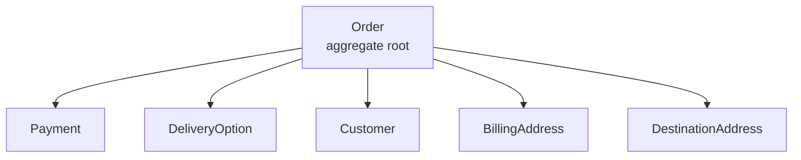

En les dues entrades anteriors hem parlat del punt de partida del projecte i de com vam construir el domini i l'equip. En aquesta toca una decisió molt menys lluïda: com connectem Shopify amb un OMS que encara estàvem desacoblant, amb una data de lliurament que no depenia de nosaltres.

## El calendari com a restricció de disseny

L'objectiu del projecte no era tenir una arquitectura millor, sinó arribar a dues dates: la campanya d'estiu i el Black Friday. Entre l'una i l'altra hi ha l'agost, amb vacances pel mig i menys mans disponibles de les que sembla en un diagrama de Gantt. Això volia dir que qualsevol decisió tècnica que ens fes perdre setmanes s'havia de justificar molt bé, i que l'MVP havia d'estar en producció al juliol de 2023.

L'arribada de Shopify la vam plantejar en dues fases: primer els mercats amb menys volum (*soft launch*) durant l'estiu, i després els més grans (*hard launch*) abans del Black Friday. El raonament és senzill: un error en un mercat petit es nota menys i es pot corregir abans que el mateix error arribi al mercat que factura. No és només una precaució de cara al client; és la manera de descobrir problemes amb un cost que encara és assumible.

## Per què vam fer l'aplicació nosaltres

Shopify recomana treballar amb un *partner*, és a dir, amb un desenvolupador o una agència especialitzada en el seu ecosistema, perquè el client tingui suport tècnic adequat. Té sentit: la plataforma està pensada perquè el comerciant no s'hagi de preocupar de res més que del negoci.

En el nostre cas vam decidir fer la integració nosaltres mateixos. La conseqüència pràctica és que, per crear una [custom app](https://shopify.dev/concepts/apps), vam haver de passar pel mateix camí que un *partner*: entendre quins tipus d'aplicació ofereix Shopify, quins permisos (*scopes*) necessita cada operació i de quins esdeveniments havíem de rebre informació. L'API està ben documentada, però documentació bona no és el mateix que familiaritat amb un ecosistema. Aquell temps de corba d'aprenentatge no apareix a cap estimació i, amb el calendari que teníem, es pagava en un altre lloc.

## Tres maneres de rebre els canvis

Vam posar sobre la taula tres opcions: *webhooks*, Google PubSub i Amazon EventBridge. Cap de les tres ens estalviava la feina de traduir el model de Shopify al nostre; el que canviava era com arribaven els esdeveniments i, sobretot, qui responia quan alguna cosa fallava.

| Opció | Què aporta | Què implica per a nosaltres | Per què la vam valorar així |
| --- | --- | --- | --- |
| *Webhooks* | Notificació HTTP directa a un endpoint nostre | Gestionem nosaltres el receptor, els reintents, la idempotència i els límits | Capaç de posar-se en marxa de seguida; encaixava amb el calendari |
| Google PubSub | Missatgeria gestionada amb lliurament asíncron i reintents | Cal integrar un servei extern i entendre'n el model de subscripcions | Hagués absorbit pics de volum, però no el coneixíem prou |
| Amazon EventBridge | Bus d'esdeveniments amb regles i filtratge | Depèn de l'ecosistema AWS i de qui publica els events | Mateix problema: menys experiència i més superfície |

Amb les setmanes que teníem i un coneixement limitat dels sistemes de missatgeria gestionada, vam triar *webhooks*. Ho dic en el sentit literal del terme *pragmàtic*: la decisió que es pot defensar amb el context d'aquell moment, no necessàriament la que hauria sortit d'un exercici de disseny sense dates.

## Què és un webhook i per què no pots respondre tard

Un *webhook* és una crida HTTP que fa Shopify contra una URL nostra quan passa alguna cosa: es crea una comanda, es paga, s'actualitza un enviament. El cos de la petició porta l'esdeveniment; en les capçaleres hi va una signatura que permet verificar que ve realment de Shopify i no de qualsevol que hagi descobert la nostra URL.

El detall que condiciona tota la resta és el temps. Shopify espera un 200 en [cinc segons](https://shopify.dev/docs/apps/build/webhooks/verify-deliveries); si no el rep, considera l'entrega fallida i la reintenta. D'aquí surten dues obligacions que no són evidents quan llegeixes la documentació per primer cop:

- La resposta s'ha de poder enviar sense haver acabat el treball. Si traduïm i desem la comanda abans de respondre, el temps de la nostra base de dades passa a formar part del temps d'entrega.
- L'operació ha de ser idempotent. Un reintent és un duplicat, i el sistema ha de saber que aquell event ja l'ha processat.

Per això vam ficar [Symfony Messenger](https://symfony.com/doc/current/messenger.html) entremig. El controlador només verificava la signatura, creava el missatge i el deixava a la cua; el consumidor feia la traducció i l'escriptura. El 200 es podia enviar sense esperar que acabés el treball real.

Això no elimina el problema, el trasllada. Si la cua s'atura, les comandes deixen d'integrar-se igualment; l'avantatge és que la fallada és visible i reintentable, en lloc de silenciosa des del punt de vista de Shopify. També obliga a decidir el transport i a tenir el consum supervisat, que és feina que amb una crida directa no hauries de fer.

## Del payload al domini: la capa ACL

El cos d'un *webhook* no és el nostre domini. Arriba amb la forma que decideix Shopify, amb els seus noms de camps, els seus estats i les seves convencions. Si deixem que aquesta forma entri al codi, Shopify passa a dictar com és el nostre model, i el desacoblament que havíem començat a la part anterior es desfà per la porta del darrere.

Per això vam construir una [Anti-Corruption Layer](https://martinfowler.com/bliki/AntiCorruptionLayer.html) que transforma el *payload* en objectes del domini abans que res més els toqui. La capa fa tres coses: valida el que arriba, tradueix els camps externs als nostres *value objects* i concentra en un sol lloc les decisions per als casos on els dos models no encaixen. Quan Shopify canvia un camp, es canvia aquí i no a vint llocs.

L'agregat `Order` del nostre domini no és una estructura plana. Està compost per diverses entitats: `Payment`, `DeliveryOption`, `Customer`, `BillingAddress` i `DestinationAddress`. El *payload* que arriba de Shopify no té aquesta forma, i la feina de l'ACL és precisament convertir-ne un en l'altre.

Per muntar-lo vam fer servir el patró *Builder*. Un constructor amb cinc paràmetres compostos és difícil de llegir i de mantenir, i no deixa lloc per validar cada part abans que formi part de l'agregat. Amb el *Builder*, cada entitat es construeix a partir del *payload* i l'`Order` només existeix quan totes les peces hi són. Així la traducció queda concentrada en un sol lloc i no escampada pel codi que consumeix l'agregat.

## La fricció que no és de codi

La part tècnica es va poder resoldre. La que va costar més va ser acceptar que Shopify té un model més estricte que el nostre i que això no és un defecte del proveïdor: és una conseqüència de vendre a molts comerços amb les mateixes regles.

El lloc on això es va notar primer no va ser el codi, sinó el vocabulari. Nosaltres teníem unificats els estats d'una comanda en un procés lineal: comanda pagada, en preparació, enviada, i uns quants més. Un sol camp, un sol enumerat, i el codi que el consultava només havia de comparar-lo amb una posició dins de la seqüència. Quan algú preguntava per una comanda, la resposta era en quin punt del procés estava.

Shopify no ho modela així. Separa quatre dimensions que nosaltres havíem barrejat en una sola:

| Eix | Què descriu |
| --- | --- |
| Estat de la comanda | Si la comanda està oberta, arxivada o cancel·lada |
| Estat del pagament | Si el cobrament està pendent, autoritzat, pagat, retornat o anul·lat |
| Estat de preparació (*fulfillment*) | Si el contingut s'ha preparat del tot, en part o gens |
| Estat de devolució | Si hi ha devolucions obertes sobre les línies de la comanda |

Els noms concrets dels valors depenen de la versió de l'API i del recurs, però la separació en quatre eixos es manté. La diferència amb el nostre model no és de nomenclatura: aquests quatre eixos es mouen de manera independent, i un sol enumerat no pot expressar el cas en què no coincideixen.

Pensa en una comanda amb tres línies. Una surt en un enviament, una altra queda pendent per falta d'estoc i el client demana tornar un tercer article que ja ha rebut. Pagament complet, preparació parcial i devolució oberta conviuen alhora. En el model lineal cal triar una sola paraula, i qualsevol paraula que triïs menteix sobre els altres eixos.

El model lineal no era un error de disseny. Funciona mentre la comanda avança en bloc: tot es paga alhora, tot es prepara alhora i tot s'envia alhora. Quan el negoci comença a vendre per canals on l'enviament parcial i la devolució per línia són normals, aquest supòsit deixa de valer, i el camp únic passa de simplificar a amagar informació.

Això té una conseqüència incòmoda: cada combinació dels quatre eixos ens obliga a decidir què vol dir amb el nostre estat únic, i en molts casos la decisió és una pèrdua. Un retorn parcial i una comanda enviada acaben col·lapsats en el mateix valor, i el que guanyem en simplicitat ho paguem en informació.

La sortida no va ser traduir millor els quatre eixos cap al nostre enumerat. Va ser qüestionar el concepte mateix. Com que ens estàvem desacoblant principalment de l'e-commerce, podíem canviar el nostre *Order Management System* sense comprometre el canal de venda principal. Així que, internament, les nostres `Order` —l'agregat que havíem muntat amb el *Builder*— van passar a ser `FulfillmentOrder`. És el que gestiona el nostre OMS: les comandes que tractem són *fulfillment orders*, la feina de preparar-les, no la comanda de venda del client.

Aquest canvi de concepte és el que ens va alliberar de la majoria d'estats. Del model de Shopify només ens interessava una pregunta: si aquella comanda s'havia de preparar o no. La resta —si el pagament estava autoritzat o capturat, si el client havia obert una devolució— no era responsabilitat nostra en aquell moment, i per tant no havíem de representar-ho.

La feina es va traslladar al negoci, que és on havia d'estar. Ens calia tenir clar en quins punts una comanda podia preparar-se, perquè fins que no rebíem l'ordre la comanda es quedava en un estat pendent, i era aquella ordre la que la passava a "En preparació". El que abans era una posició dins d'una seqüència va passar a ser una decisió amb regles explícites.

Aquí és on la fricció deixa de ser tècnica. El codi de traducció és mecànic un cop saps què vols dir; el que costa és acordar què vol dir cada paraula amb el negoci, perquè és el mateix vocabulari que fan servir per parlar amb el client. Acceptar que una part del nostre model era més pobra del que pensàvem no es va resoldre amb una capa de traducció: es va resoldre decidint que no havíem de representar allò que no ens tocava.

## Juliol: el pla de sortida

Amb la data límit de la campanya d'estiu al juliol de 2023, vam prioritzar tres coses:

1. **Proves de rendiment.** Tests d'estrès per comprovar que el sistema aguantava el que li havíem de demanar.
2. **Soft launch.** Migració progressiva de mercats a Shopify a partir del 17 de juliol, per poder revertir sense que afectés tothom alhora.
3. **Monitoratge i ajustos.** Identificació de problemes i recollida de *feedback* durant l'agost, amb marge per corregir abans del *hard launch*.

El pla era raonable i el vam complir. El que no teníem al diagrama era una altra cosa: els sistemes nostres que encara apuntaven al domini antic.

## Setembre: el que els tests no havien vist

Durant el *hard launch*, al setembre, van ser uns dies caòtics. Les comandes seguien entrant pels *webhooks*; l'OMS les rebia i les processava. El que va fallar va ser la comunicació de l'OMS cap a Shopify: al nostre sistema tot era correcte, però les actualitzacions es quedaven a la cua fins que vam poder tornar a enviar-les. A l'e-commerce, les comandes no s'actualitzaven: ni l'estat, ni la informació d'enviament, ni el número de seguiment, ni el transportista. Això afectava el client i el nostre equip d'atenció al client.

La causa era una aplicació legacy que feia peticions al nostre e-commerce de manera recorrent: un script amb *threads* que actualitzava informació de comandes. Quan vam passar el domini principal a Shopify, aquell script va continuar fent la mateixa feina, però les seves peticions anaven a adreces de Shopify que no existien. Cada crida era un 404, i Shopify va bloquejar la nostra IP.

El segon problema va ser l'abast. Aquella IP no era només de la integració: hi havia diversos sistemes que hi sortien, el mateix OMS i una altra aplicació de *loyalty*. Quan Shopify va bloquejar l'adreça, no va bloquejar el script; va bloquejar tot el que sortia cap a Shopify. Per això l'OMS podia continuar treballant i no podia notificar res a l'e-commerce.

Els tests d'estrès mesuren la nostra infraestructura amb càrrega sintètica. No mesuren que hi hagi un client nostre, oblidat, apuntant a una URL que hem deixat de servir, ni que la nostra adreça de sortida sigui compartida amb sistemes que no formen part de la integració. En tots dos casos la fallada no ve del que el proveïdor ens envia, sinó del que el proveïdor rep de nosaltres.

## Diagnosticar des de fora

L'error era nostre, i això no ho discuteixo. El que va fer el problema molt més car del que calia va ser el temps que vam trigar a saber què passava, i en això no hi vam tenir tota la culpa.

Quan tens la IP bloquejada, el que necessites no és un article de documentació: necessites que algú de dins et digui per què. El camí habitual és obrir un cas al suport i esperar. En el nostre cas això es va convertir en un periple. Diversos contactes amb agents diferents, cadascun començant de zero, i el nostre *key account* sense donar-hi resposta. La sensació va ser d'ignorància i de desatenció més que de dificultat tècnica.

El punt d'inflexió va ser trobar un agent que s'ho va prendre mig seriosament i ens va donar pistes sobre on podien ser els problemes. Amb aquelles idees vam poder mirar en la direcció correcta. No sé si hauria estat així amb un altre proveïdor, i no ho puc afirmar; el que sí que puc dir és que la diferència entre un agent i un altre va decidir quant de temps vam estar bloquejats.

Del cost d'això se'n parla poc quan es compara un servei amb un altre. Quan tries com integrar-te amb una plataforma, la documentació és la part visible. L'altra part és què passa quan la documentació no respon la teva pregunta, i això només ho descobreixes quan ja hi ets a dins.

## Els webhooks no eren el problema

Amb la IP bloquejada, vam tornar a les tres opcions del principi. El *webhook* és un HTTP contra una URL nostra: Shopify espera un 200 en cinc segons i, si no el té, reintenta. EventBridge i Pub/Sub deixen els events en un bus; Shopify ja no espera el 200 a casa nostra. Sembla que, si haguéssim triat el bus, setembre hauria anat d'una altra manera.

Les comandes, però, seguien entrant. Shopify continuava cridant el nostre endpoint, el controlador continuava responent 200 i Messenger continuava deixant el missatge a la cua. L'OMS tenia les comandes i les podia preparar. El que havíem assumit en triar HTTP —el temps, els duplicats, que dues notificacions de la mateixa comanda poden arribar intercanviades— no es va trencar aquella setmana.

Es va trencar l'altra direcció. L'OMS volia actualitzar Shopify, i aquelles peticions sortien per la mateixa IP que el script que rebia 404. Shopify va bloquejar l'adreça i tot el que anava cap a ells va parar. Un bus no hauria canviat el camí de sortida. EventBridge i Pub/Sub diuen on Shopify envia els events; no diuen per on sortim nosaltres cap a l'Admin API, ni quin script antic continua cridant una URL que ja no existeix, ni quant triga el suport a explicar-nos el bloqueig.

Si més endavant canviem com arriben els events, haurà de ser per un problema d'entrada. Aquest no ho era.

## Balanç

La integració va complir l'objectiu: al juliol l'MVP era en producció i els mercats petits van començar a operar amb Shopify. També va deixar una base aprofitable, perquè la traducció del model i l'ACL són independents del transport que hi hagi a sota.

El preu va ser carregar sobre la nostra aplicació la responsabilitat de la fiabilitat d'una integració que no controlem. Això s'aguanta si el volum és el que havies previst i si tot el que et rodeja està al dia. Al setembre vam comprovar que cap de les dues coses es pot donar per feta: les comandes seguien entrant, però no podíem dir-li res a Shopify. La que ens va deixar així no va ser la càrrega del proveïdor, sinó un script nostre que encara cridava al domini d'abans.

I una cosa que no surt als diagrames: mentre la cua s'omplia, el temps de reparació no el va marcar la nostra capacitat tècnica, sinó la velocitat amb què vam aconseguir que algú del proveïdor ens fes cas.
